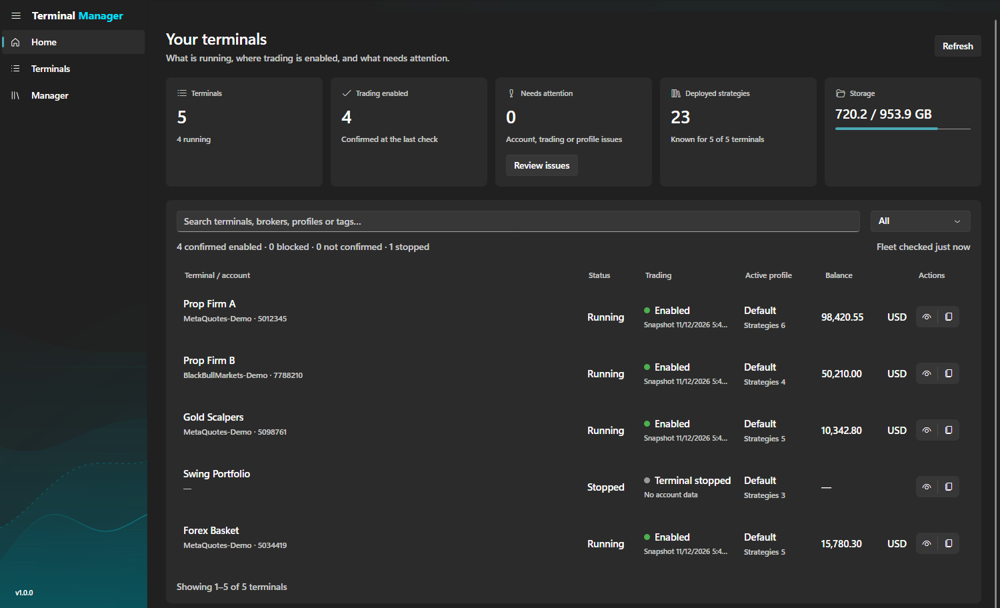
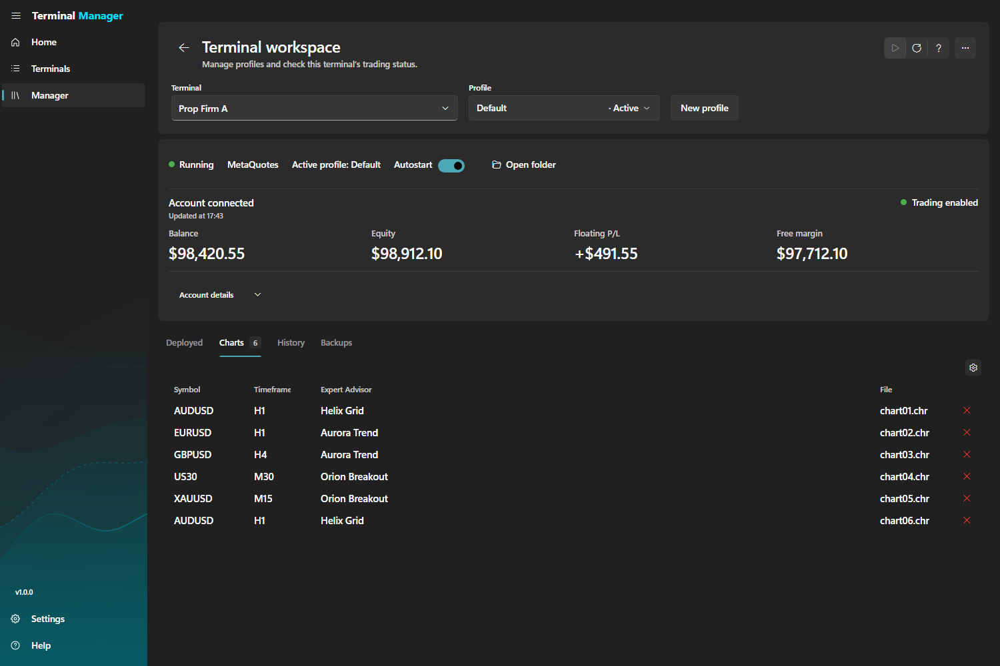
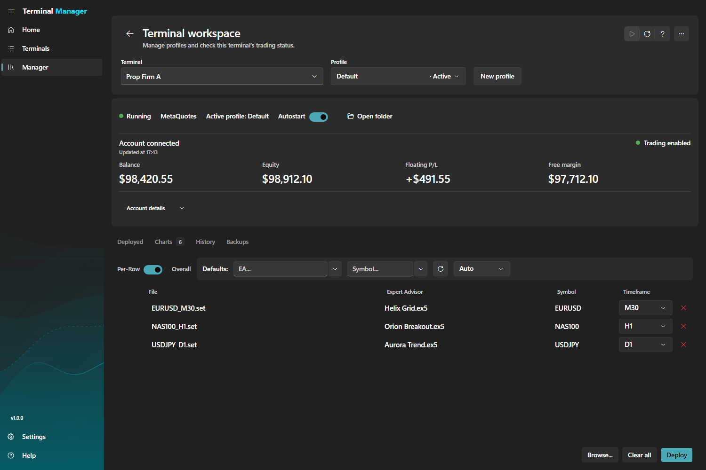
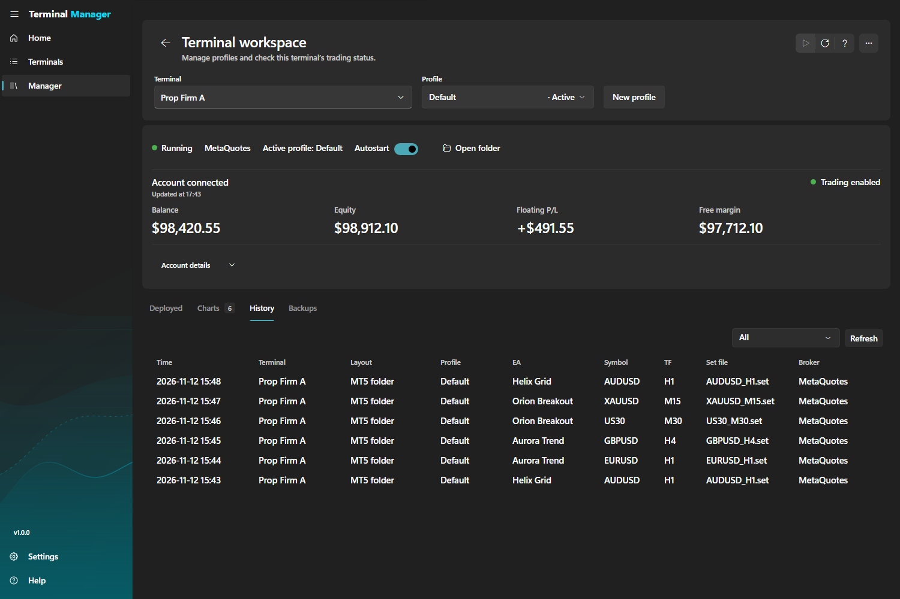
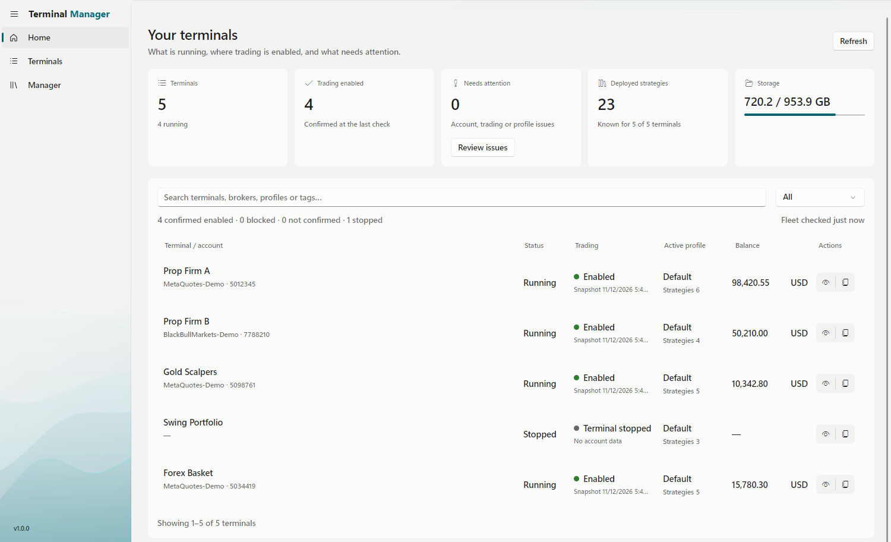
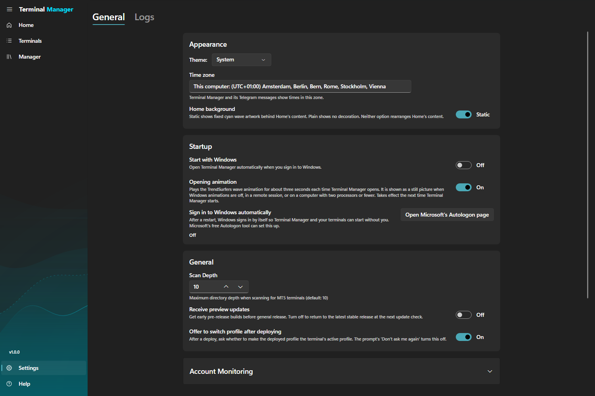

# **Terminal Manager**

Keep all your MetaTrader 5 terminals in one place. See which ones are running and where trading is enabled, and turn your Expert Advisor `.set` files into chart profiles that are ready to load.

[**Download the latest version**](https://github.com/trendsurfers-software/terminal-manager/releases/latest) · [trendsurfers.io](https://trendsurfers.io/)

  

---

## What it is

**Terminal Manager** is a free Windows app for traders who run one or more MetaTrader 5 terminals. It finds the terminals on your computer, shows how each one is doing, and helps you put Expert Advisor settings onto your charts without clicking through every terminal by hand. It also keeps a record of what was deployed, where and when.

Terminal Manager is free to use. Features that are free today may become paid in a future version; a feature that is free in the version you have installed stays free in that version.

## What you can do

- **Find every terminal.** Scan your computer for MetaTrader 5 installations, portable and standard, and add them to one list.
- **See the whole picture on Home.** How many terminals are running, where trading is enabled, which ones need attention, how many strategies are deployed and how full your drives are. Search by terminal, broker, profile or tag. Trading status and account checks need **Monitor account balances** turned on in Settings.
- **Tag your terminals.** Mark them "prop", "demo" or "VPS 2" and filter by tag.
- **Start terminals automatically.** Switch on Autostart for the terminals you want. Terminal Manager opens them when it starts and tells you if one has stopped.
- **Check the account.** Set the account a terminal should be using, and Terminal Manager tells you if it ever changes.
- **Go from `.set` files to charts.** Add your `.set` files, pick the Expert Advisor, symbol and timeframe for each one (or set them for all files at once), and deploy them as a chart profile.
- **Deploy with safety checks.** A deployment stops when a symbol does not exist at the terminal's broker, and you are warned about clashing magic numbers and before strategies are written to a live account. If a deployment cannot be finished, your profile is put back as it was.
- **Back up and restore.** Every deployment keeps a backup of the whole profile, and you can restore one whenever you need to.
- **Keep a history.** A record of every deployment: terminal, profile, Expert Advisor, symbol, timeframe and the `.set` file it came from.
- **Light and dark themes**, your own time zone for every time shown, and an optional start with Windows.

## Screenshots

  
   <em>Terminals: every terminal in one list, with status, broker, tags and Autostart</em>

  
   <em>Terminal workspace: account status and the charts on a profile</em>

  
   <em>Add strategies: choose the Expert Advisor, symbol and timeframe for each .set file, then deploy</em>

  
   <em>History: what was deployed, where and when</em>

  
   <em>Home in the light theme</em>

  
   <em>Settings: theme, time zone, startup and updates</em>

The screenshots show sample terminals and demo accounts.

---

## Download and install

1. Download the installer, `TS.TerminalManager-win-Setup.exe`, from the [latest release](https://github.com/trendsurfers-software/terminal-manager/releases/latest). A portable `.zip` is there too.
2. Run the installer and open **Terminal Manager**.
3. Scan for your terminals and add the ones you want to manage.

Terminal Manager checks for a new version each time it starts and shows a banner. You choose when to download and install it. To try preview versions before they are released to everyone, turn on **Receive preview updates** in Settings.

## System requirements

- Windows 10 (version 1809 or later) or Windows 11, 64-bit
- MetaTrader 5

## Licence and privacy

By installing or using Terminal Manager you agree to the End User License Agreement. Terminal Manager asks you to accept it the first time it starts.

| Document | Link |
|----------|------|
| End User License Agreement | [trendsurfers.io/eula-mtm/](https://trendsurfers.io/eula-mtm/) |
| Privacy Policy | [trendsurfers.io/privacy/](https://trendsurfers.io/privacy/) |
| Legal Notice | [trendsurfers.io/legal/](https://trendsurfers.io/legal/) |
| Trademark Notices | [trendsurfers.io/legal/#trademarks](https://trendsurfers.io/legal/#trademarks) |

## Support and community

| Channel | Link |
|---------|------|
| Questions and support | [hello@trendsurfers.io](mailto:hello@trendsurfers.io) |
| Bugs and requests | [GitHub issues](https://github.com/trendsurfers-software/terminal-manager/issues) |
| Discord | [discord.gg/3HnQDZ5hT5](https://discord.gg/3HnQDZ5hT5) |
| Telegram | [Community group](https://t.me/+GyaH3OhxW802N2I0) |
| Legal | [legal@trendsurfers.io](mailto:legal@trendsurfers.io) |

## What is new

See [CHANGELOG.md](CHANGELOG.md) and the [releases](https://github.com/trendsurfers-software/terminal-manager/releases).

---

## Legal notices

**Terminal Manager** is an independent product developed by **INFINITYDEV, S.L.** (NIF B-44974798, Plaça Jardí Enric Morera 2, Bajos, 17600 Figueres, Girona, Spain).

INFINITYDEV, S.L. is not affiliated with, endorsed by, sponsored by, certified by, or otherwise connected to MetaQuotes Ltd or any of its affiliated entities. This product is not approved by MetaQuotes, and MetaQuotes provides no warranty, support, or representation regarding it.

"MetaTrader", "MetaTrader 4", "MetaTrader 5", "MT4", "MT5", "MQL4", and "MQL5" are registered trademarks of MetaQuotes Ltd and/or its affiliated entities. All other product names, trademarks, service marks, and registered trademarks referenced in this software or its accompanying materials are the property of their respective owners and are used solely for identification and descriptive purposes. Such use does not imply endorsement, sponsorship, or any affiliation between INFINITYDEV, S.L. and the trademark holders.

**Trading risk.** Trading foreign exchange and derivatives carries a high level of risk and may not be suitable for all investors. Past performance is not indicative of future results. Terminal Manager is a terminal-management tool. It deploys Expert Advisor configurations to your own MetaTrader 5 terminals and can read basic account information from them when account monitoring is on. It does not place trades, and it does not provide financial advice or trading signals.

**Platform dependency.** Terminal Manager operates on your own MetaTrader 5 installations and depends on specific MetaTrader 5 capabilities for its operation, including terminal detection, chart-profile formats, and `.set` file formats. MetaQuotes Ltd is an independent third party over which INFINITYDEV, S.L. has no control. MetaQuotes may, at any time, modify, restrict, deprecate, or remove any MetaTrader 5 capability. Such changes may cause parts or all of this software to stop functioning. This does not constitute a defect in the software, and INFINITYDEV, S.L. assumes no responsibility for changes made by MetaQuotes or any other third-party platform.

&copy; 2024-2026 INFINITYDEV, S.L. All rights reserved.
