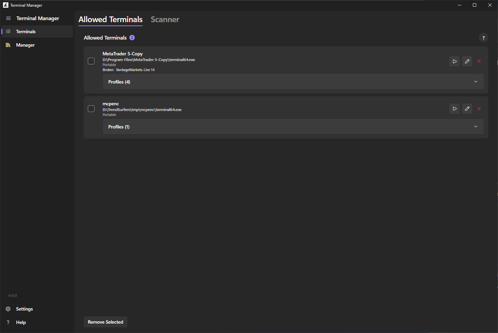
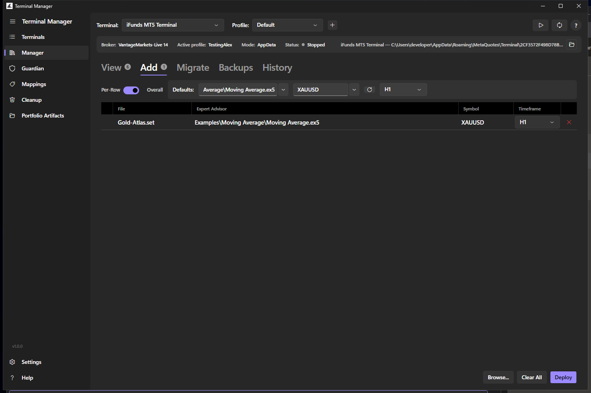
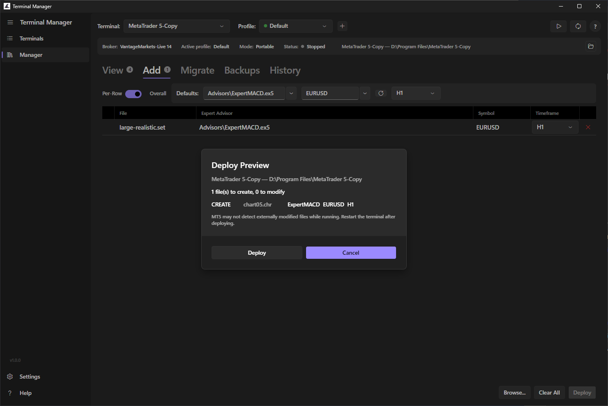
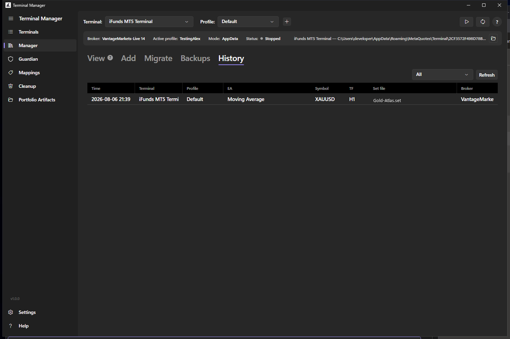

# TrendSurfers Terminal Manager

> A free Windows desktop app for managing your MetaTrader 5 terminals — find every terminal, turn your Expert Advisor `.set` files into ready-to-load chart profiles, and keep a full history of every deployment.

**Website:** [trendsurfers.io](https://trendsurfers.io/)

---

## What Is It?

**TrendSurfers Terminal Manager** is a companion app for MetaTrader 5 traders who run one or more terminals. Instead of clicking through each MT5 install by hand, Terminal Manager gives you a single dashboard to find and manage your terminals, import folders of Expert Advisor `.set` files, and deploy them as ready-to-load chart profiles — with a full record of what was deployed, where, and when.

Terminal Manager is **completely free** to use.

---

## Screenshots

  
   <em>Terminals — find and manage every MetaTrader 5 install</em>

  
   <em>Manager — import .set files and assign EA, symbol, and timeframe with searchable dropdowns</em>

  
   <em>Manager — deploy as a ready-to-load chart profile in a few clicks</em>

  
   <em>Deployment History — a full, traceable record of what was deployed, where, and when</em>

---

## Core Features

### 🖥️ Terminal Management
- Scan your machine for MetaTrader 5 installations — portable and standard installs alike.
- See every terminal in one dashboard and add the ones you want to manage.

### 📥 Import, Assign & Deploy
- Import your Expert Advisor `.set` files.
- Pick the EA, symbol, and timeframe with smart, searchable dropdowns — bulk-assign across multiple files at once.
- Deploy the result as a ready-to-load chart profile to any managed terminal, in a few clicks.

### 🧾 Deployment History
- A full, traceable record of every deployment.
- See terminal, profile, EA, symbol, timeframe, and the exact `.set` file it came from — for every deployment, every time.

### 🔄 Automatic Updates
- Terminal Manager keeps itself current in the background — no manual downloads.
- Enable the preview channel in Settings for early access to new features before general release.

---

## System Requirements

- **Operating System**: Windows 10 or Windows 11 (64-bit)
- **MetaTrader 5**: One or more installed terminals

---

## Installation

1. Download the latest `TS.TerminalManager-win-Setup.exe` from [Releases](../../releases).
2. Run the installer. Terminal Manager installs per-user and updates itself automatically.
3. Launch **Terminal Manager** and add your first MetaTrader 5 terminal.

### Preview builds

Want early access to new features? In **Settings → Receive preview updates**, enable preview updates to receive pre-release builds before general availability. Uncheck it at any time to return to the stable channel on the next update check.

---

## Contact & Community

| Channel | Link |
|---------|------|
| Website | [trendsurfers.io](https://trendsurfers.io/) |
| Discord | [discord.gg/3HnQDZ5hT5](https://discord.gg/3HnQDZ5hT5) |
| Telegram | [Community group](https://t.me/+GyaH3OhxW802N2I0) |
| General / Support | [hello@trendsurfers.io](mailto:hello@trendsurfers.io) |
| Legal | [legal@trendsurfers.io](mailto:legal@trendsurfers.io) |

---

## License

Terminal Manager is free to use. By downloading, installing, or using this software you agree to the [End User License Agreement](https://trendsurfers.io/eula-mtm/). If you do not accept the EULA, do not install or use the software.

| Legal document | Link |
|---------------|------|
| End User License Agreement (EULA) | [trendsurfers.io/eula-mtm/](https://trendsurfers.io/eula-mtm/) |
| Privacy Policy | [trendsurfers.io/privacy/](https://trendsurfers.io/privacy/) |
| Legal Notice (Aviso Legal) | [trendsurfers.io/legal/](https://trendsurfers.io/legal/) |
| Trademark Notices | [trendsurfers.io/legal/#trademarks](https://trendsurfers.io/legal/#trademarks) |

---

## Legal Notices

### Trademark Disclaimers

**TrendSurfers Terminal Manager** is an independent product developed by **INFINITYDEV, S.L.** (NIF B-44974798, Plaça Jardí Enric Morera 2, Bajos, 17600 Figueres, Girona, Spain).

INFINITYDEV, S.L. is **not** affiliated with, endorsed by, sponsored by, certified by, or otherwise connected to MetaQuotes Software Corp., MetaQuotes Ltd., or any of their affiliated entities. This product is not approved by MetaQuotes, and MetaQuotes provides no warranty, support, or representation regarding it.

"MetaTrader", "MetaTrader 4", "MetaTrader 5", "MT4", "MT5", "MQL4", and "MQL5" are registered trademarks of MetaQuotes Software Corp. and/or its affiliated entities. All other product names, trademarks, service marks, and registered trademarks referenced in this software or its accompanying materials are the property of their respective owners and are used solely for identification and descriptive purposes. Such use does not imply endorsement, sponsorship, or any affiliation between INFINITYDEV, S.L. and the trademark holders.

### Trading Risk Disclaimer

Trading foreign exchange and derivatives carries a high level of risk and may not be suitable for all investors. Past performance is not indicative of future results. Terminal Manager is a terminal-management tool — it deploys Expert Advisor configurations to your own MetaTrader 5 terminals but does not place trades, connect to live broker accounts, or provide financial advice or trading signals.

### Platform Dependency Notice

Terminal Manager operates on your own MetaTrader 5 installations and depends on specific MT5 capabilities for its operation (including terminal detection, chart-profile formats, and `.set` file formats). MetaQuotes Software Corp. is an independent third party over which INFINITYDEV, S.L. has no control. MetaQuotes may, at any time, modify, restrict, deprecate, or remove any MT5 capability. Such changes may cause parts or all of this software to stop functioning. This does not constitute a defect in the software, and INFINITYDEV, S.L. assumes no responsibility for changes made by MetaQuotes or any other third-party platform.

&copy; 2024–2026 INFINITYDEV, S.L. All rights reserved.
